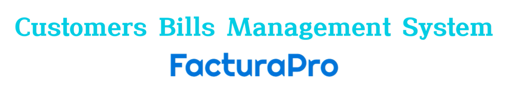
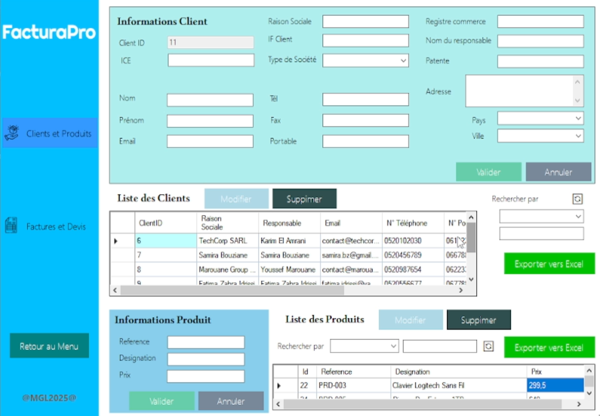
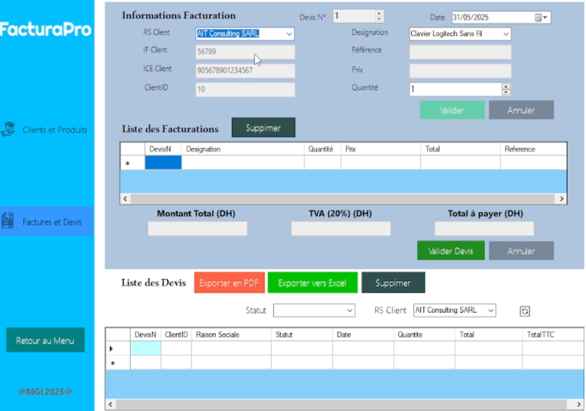
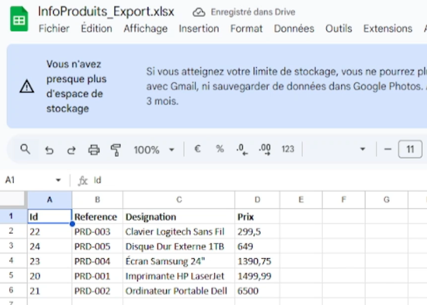
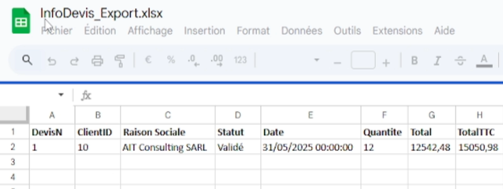
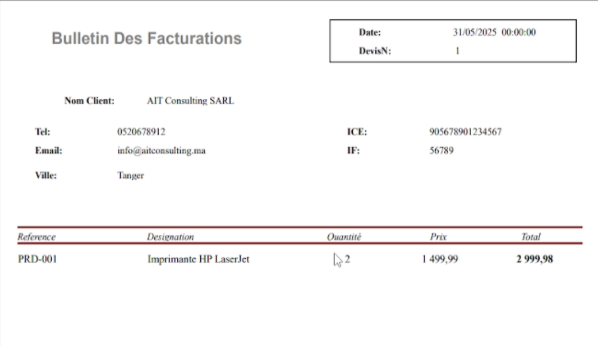
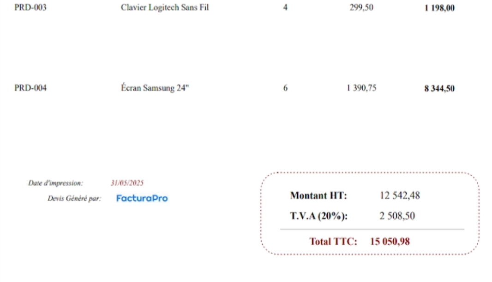
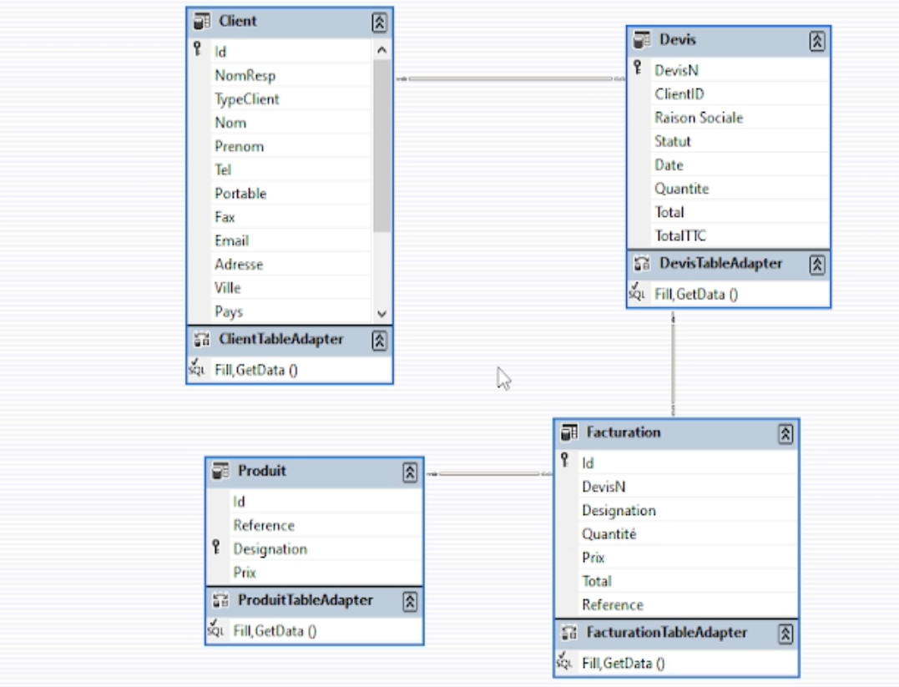

# FacturaPro — Customers Bills Management System

FacturaPro is a Windows desktop application project for managing customer and product information and preparing quotations and invoices. The screenshots and design image in [`assets/`](assets/) illustrate the intended billing workflow and interface.


## Project Information

| Item | Details |
| --- | --- |
| Application type | Windows Forms desktop application |
| Language | C# |
| Target framework | .NET Framework 4.8 |
| Solution | `LAHLOUH_MohamedElGhali.sln` |
| Main form | `LAHLOUH_MohamedElGhali/Form1.cs` |
| Interface language in screenshots | French |

## Intended application workflow

The assets describe a small business billing workflow:

- **Customers:** enter and browse company and contact details, including company name, customer type, tax/registration identifiers, contact information, address, city, and country.
- **Products:** maintain product references, descriptions, and prices.
- **Quotations and invoices:** select a customer and products, enter quantities and dates, and review line totals and document totals.
- **Tax and totals:** the illustrated invoice screen displays a 20% VAT amount and a total including tax (TTC).
- **Exports:** buttons and sample documents illustrate exporting lists to Excel and a quotation/invoice document to PDF.

These capabilities are inferred from the project screenshots and data-model diagram. They are not implemented by the current C# form.

## Current source-code behavior

The current `Form1` form accepts a credit amount, annual interest rate, loan duration, and salary. It calculates a monthly repayment using the annual rate converted to a monthly rate, then compares the repayment with one quarter of the entered salary:

```text
monthly payment = principal × monthly rate
                  / (1 − (1 + monthly rate) ^ (−number of months))
```

If the payment is within that threshold, the form reports that the applicant is eligible. Otherwise, it reveals a second section where the user can try another credit amount and a revised duration in years and months. The result is shown using Windows Forms message boxes.

The current source does not include customer/product/invoice data classes, persistence configuration, or PDF/Excel export code. The data-model image and billing screenshots are reference material only until the source and visuals are brought into alignment.

## Screenshots and design assets

The following images are included in the repository and document the intended FacturaPro experience:

### 

### Main menu


### Customers and Products




### Quotations and invoices




### Example document and exports

Exported product data 



Exported Quotation data 


Exported invoice data 



### Data-model reference



The diagram depicts `Client`, `Produit`, `Devis`, and `Facturation` tables and their relationships. It is a visual design artifact; the data is stored locally in MSSQL.

## Technology and requirements

To open and build the checked-in application:

- Windows
- Visual Studio with the .NET desktop development workload
- .NET Framework 4.8 targeting pack/developer pack

The solution uses Windows Forms and the standard .NET Framework libraries. The project file does not declare a database provider or third-party package dependency.

## Build and run

1. Open `LAHLOUH_MohamedElGhali.sln` in Visual Studio.
2. Allow Visual Studio to load the project targeting .NET Framework 4.8.
3. Select the `LAHLOUH_MohamedElGhali` project as the startup project.
4. Build the solution, then press **F5** to run it.